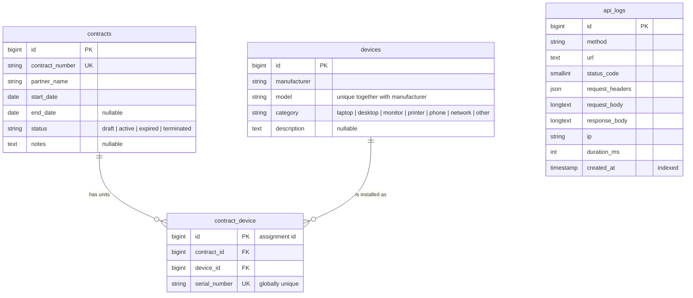

# Device Registry

[](https://github.com/marton-laszlo-attila/device-registry/actions/workflows/ci.yml)

REST API (Laravel 13, PHP 8.5, MySQL 8.4) that keeps track of contracts and the devices on them. A device type can be on many contracts; every physical unit is identified by its own serial number.

The Laravel application lives in `api/`. The repository root holds the Docker setup, `docs/` and the `Makefile`. There is no frontend, so Vite and npm are not used.

## Contents

[Requirements coverage](#requirements-coverage) · [Quick start](#quick-start) · [API documentation](#api-documentation) · [Endpoints](#endpoints) · [Data model](#data-model) · [Error format](#error-format) · [API traffic logging](#api-traffic-logging) · [Architecture and design decisions](#architecture-and-design-decisions) · [Quality](#quality) · [Security](#security) · [Development process](#development-process) · [Testing](#testing)

## Requirements coverage

Paths are relative to `api/`. Tests are in `tests/Feature/`.

| Requirement (`docs/task.txt`) | Solution | Verified by |
|---|---|---|
| Device create, update, delete, list, show | `DeviceController`, `DeviceService`, `/api/v1/devices` | `RequirementsTest` (device CRUD), `DeviceTest` |
| Contract create, update, delete, list, show | `ContractController`, `ContractService`, `/api/v1/contracts` | `RequirementsTest` (contract CRUD), `ContractTest` |
| Contract detail shows its devices, the list does not | `ContractResource` includes `devices` only when `assignments` is loaded (detail only) | `RequirementsTest` (detail vs. list) |
| Add a device to / remove it from a contract | `POST /contracts/{contract}/devices`, `DELETE /contracts/{contract}/devices/{assignment}`, `ContractDeviceController` | `RequirementsTest` (add and take off), `ContractDeviceTest` |
| Device type on several contracts, a different serial number per unit (N:N) | pivot table `contract_device` with a unique `serial_number` | `RequirementsTest` (N:N), `DomainModelTest` |
| CRUD REST API | `routes/api.php`, versioned under `/api/v1` | `DeviceTest`, `ContractTest`, `ContractDeviceTest` |
| Consistent error handling | one handler in `bootstrap/app.php`, `ApiException` / `ConflictException` | `ErrorHandlingTest` |
| API traffic (request and response) logged in the database | `LogApiTraffic` middleware, `ApiLog` model, `api_logs` table | `ApiLoggingTest` |
| OpenAPI documentation at a public URL behind Basic Auth | Scramble, `DocsBasicAuth` middleware, `/docs/api` and `/docs/api.json` | `ApiDocsTest` |
| Laravel 13, PHP 8.5, MySQL | `composer.json`, `docker/php/Dockerfile`, `docker-compose.yaml` (MySQL 8.4) | the whole suite runs on the Docker stack and in CI |
| Clean code (SOLID, DRY) | thin controllers, services behind interfaces, shared validation rules | `ArchTest`, see [Architecture](#architecture-and-design-decisions) |
| PSR-4 and PSR-12 | Pint (PSR-12 preset) and PHP_CodeSniffer, `composer dump-autoload --strict-psr` | `make qa`, CI |
| Docker package | `docker-compose.yaml`: app (PHP-FPM), nginx, MySQL, scheduler | [Quick start](#quick-start) |
| Project can be set up from migrations | `database/migrations`, `php artisan migrate:fresh --seed` | `SeederTest`, CI (`migrate:fresh --seed`) |

"Public URL" is the `/docs/api` route of this repository, protected by Basic Auth. Deployment was not required (confirmed by the task owner).

## Quick start

Requirements: Docker with Compose v2 and `make`. PHP does not need to be installed locally.

```bash
git clone https://github.com/marton-laszlo-attila/device-registry.git
cd device-registry

make up        # creates .env with random MySQL passwords, builds the images, starts app, nginx, mysql, scheduler
make install   # composer install, creates api/.env from api/.env.example, generates the app key

# Credentials of the documentation (Basic Auth). Empty values deny all access.
sed -i 's/^DOCS_USERNAME=.*/DOCS_USERNAME=docs/; s/^DOCS_PASSWORD=.*/DOCS_PASSWORD=change-me/' api/.env

make fresh     # migrate:fresh --seed (demo data: 4 devices, 3 contracts, 5 assigned units)
```

The API is now served on http://localhost:8080 (bound to `127.0.0.1` only, as it has no authentication). MySQL listens on `127.0.0.1:3307`. Both ports can be changed in the root `.env` (`APP_PORT`, `MYSQL_PORT`).

```bash
curl -s http://localhost:8080/api/v1/contracts | jq
```

The `scheduler` container exits on a fresh clone until `make install` has created `vendor/`; Docker restarts it automatically afterwards.

<details>
<summary>Without <code>make</code></summary>

Since the MySQL passwords are no longer hardcoded, `docker compose` refuses to start without a root `.env`:

```bash
cp .env.example .env            # then fill in DB_PASSWORD and MYSQL_ROOT_PASSWORD
docker compose up -d --build
docker compose exec app composer install
cp api/.env.example api/.env    # then set DOCS_USERNAME and DOCS_PASSWORD
docker compose exec app php artisan key:generate --force
docker compose exec app php artisan migrate:fresh --seed --force
```

On Linux, set `UID` and `GID` in the root `.env` if your ids are not 1000 (the app container writes files into `api/` with them).

</details>

Other targets: `make down`, `make shell`, `make migrate` (all in the `Makefile`).

## API documentation

The OpenAPI specification is generated from the code by [Scramble](https://scramble.dedoc.co) (no annotations to maintain).

| | |
|---|---|
| Interactive UI | http://localhost:8080/docs/api |
| OpenAPI JSON | http://localhost:8080/docs/api.json |
| Exported copy | [`api/docs/openapi.json`](api/docs/openapi.json) (kept in sync by a test; refresh with `docker compose exec app php artisan scramble:export`) |
| Credentials | `DOCS_USERNAME` / `DOCS_PASSWORD` from `api/.env` |

```bash
curl -u docs:change-me http://localhost:8080/docs/api.json | jq '.paths | keys'
```

Without or with wrong credentials the answer is `401` with `WWW-Authenticate: Basic`; more than 10 failed attempts per minute from one IP get `429`.

## Endpoints

Base path `/api/v1`. Send `Accept: application/json` (and `Content-Type: application/json` for bodies; the API answers JSON either way).

| Method | Path | Success | Notes |
|---|---|---|---|
| GET | `/devices` | 200 | paginated (`page`, `per_page` 1–100, default 15) |
| POST | `/devices` | 201 | `manufacturer`, `model`, `category`, `description?` |
| GET | `/devices/{device}` | 200 | |
| PUT/PATCH | `/devices/{device}` | 200 | both accept a partial body |
| DELETE | `/devices/{device}` | 204 | `409` if the device is on a contract |
| GET | `/contracts` | 200 | paginated, **without** devices |
| POST | `/contracts` | 201 | `contract_number`, `partner_name`, `start_date`, `end_date?`, `status`, `notes?` |
| GET | `/contracts/{contract}` | 200 | **with** devices (assignment id, serial number, device type) |
| PUT/PATCH | `/contracts/{contract}` | 200 | both accept a partial body |
| DELETE | `/contracts/{contract}` | 204 | `409` if devices are assigned |
| POST | `/contracts/{contract}/devices` | 201 | body: `device_id`, `serial_number` |
| DELETE | `/contracts/{contract}/devices/{assignment}` | 204 | an assignment of another contract answers `404` |

Enums: `category` is one of `laptop`, `desktop`, `monitor`, `printer`, `phone`, `network`, `other`; `status` is one of `draft`, `active`, `expired`, `terminated`. Dates are `Y-m-d`.

Examples (the seeded database already contains devices 1–4 and contracts 1–3):

```bash
H='Content-Type: application/json'

# 1. Create a device type
curl -s -X POST localhost:8080/api/v1/devices -H "$H" -H 'Accept: application/json' \
  -d '{"manufacturer":"Lenovo","model":"ThinkPad T14","category":"laptop"}' | jq

# 2. Put a unit of it on contract 2 (the response contains the assignment id)
curl -s -X POST localhost:8080/api/v1/contracts/2/devices -H "$H" -H 'Accept: application/json' \
  -d '{"device_id":5,"serial_number":"TP-T14-0001"}' | jq

# 3. Read the contract with its devices
curl -s localhost:8080/api/v1/contracts/2 | jq

# 4. Take the unit off again (assignment id from step 2)
curl -s -X DELETE localhost:8080/api/v1/contracts/2/devices/6 -i | head -1
```

## Data model



- A **device** is a device *type* (manufacturer + model). The physical unit is a row of `contract_device` with its `serial_number`.
- The relation is N:N: one type can be on many contracts, and several times on the same contract, but every unit has a different serial number.
- The serial number is unique **across all contracts**: a physical unit can be on one contract at a time. To move it, remove the assignment and add it again.
- `contract_device` has its own `id`, so a unit can be removed with a single, unambiguous URL, and extra columns (e.g. `returned_at`) can be added later without touching the controllers.
- Foreign keys are `RESTRICT`: nothing is deleted in a cascade, and there is no soft delete.
- The schema is built only by the migrations in `api/database/migrations`.

## Error format

Every error of the API has the same shape; `errors` is present on validation failures only.

```json
{
  "message": "The serial number has already been taken.",
  "errors": { "serial_number": ["The serial number has already been taken."] }
}
```

| Status | When |
|---|---|
| 404 | unknown resource or route (the message never names the model class or the id) |
| 405 | method not allowed |
| 409 | deletion of a device or contract that is in use; a concurrent request won the race for a unique key or a foreign key |
| 415 / 422 | a body that is not JSON / validation failure, including malformed JSON |
| 429 | rate limit: 60 requests per minute per IP |
| 500 | unexpected error; no trace and no internal message unless `APP_DEBUG=true` |

Client errors (4xx) never contain debug details, not even with `APP_DEBUG=true`: only server errors show a trace in debug mode.

## API traffic logging

The `LogApiTraffic` middleware stores every request under `/api` and its response in the `api_logs` table, in `terminate()`, after the response has been sent. Unknown routes (404, 405) and throttled requests (429, stored without headers and body, to keep such rows small) are logged too. A logging failure never changes the API response.

| Stored | Details |
|---|---|
| Request | method actually sent, full URL, headers, body, client IP |
| Response | status code, body, duration in ms |
| Masked | the values of `Authorization`, `Proxy-Authorization`, `Cookie`, `X-Api-Key`, CSRF/XSRF headers and the `PHP_AUTH_*` values are stored as `***` (list in `config/api_logging.php`) |
| Limits | bodies are cut at 65,535 bytes (marked `... [truncated]`); invalid UTF-8 is replaced by `?` so a row can always be written |
| Not logged | traffic outside `/api`, including the documentation |
| Retention | rows older than `API_LOG_RETENTION_DAYS` (default 30) are deleted daily by the scheduler (`MassPrunable`); `API_LOGGING_ENABLED=false` turns logging off |

```bash
docker compose exec mysql sh -c 'mysql -uroot -p"$MYSQL_ROOT_PASSWORD" device_registry \
  -e "SELECT id, method, url, status_code, duration_ms, created_at FROM api_logs ORDER BY id DESC LIMIT 5"'
```

## Architecture and design decisions

```
Request → rate limit → LogApiTraffic → FormRequest (validation)
        → Controller (thin) → Service (business rules) → Eloquent model
        → API Resource (response)
Any exception → withExceptions() in bootstrap/app.php (one place)
```

| Layer | Responsibility |
|---|---|
| Form Request | validation; the rules for create and update are shared (`Update*Request` extends `Store*Request` and makes fields optional) |
| Controller | HTTP only: validated data in, Resource and status code out; no queries, no business `if` |
| Service + interface | listing, writes and business rules (delete guards, assignment); the controllers depend on `App\Services\Interfaces\*` |
| Model | relations, casts, `$fillable` |
| API Resource | response shape, separate from the database schema |
| Exceptions | `ApiException` (abstract, carries the HTTP status) and `ConflictException` (409, named constructors) |

Decisions and the reasons behind them:

- **Simple on purpose.** The task is a small CRUD API, so the code uses what Laravel already provides (Form Request, Resource, route model binding, exception handler). There is **no repository layer** (Eloquent already is one; a wrapper would only repeat it), no DTOs (the service takes the validated array) and no CQRS or event layer. The place for each future change is still unambiguous (see below).
- **Service interfaces anyway.** They cost a few lines and make the Dependency Inversion Principle visible: a controller asks for the interface (an architecture test enforces it), so an alternative implementation (cached listing, an external-system sync) is a new class plus one line in `AppServiceProvider::$bindings`. They live in `App\Services\Interfaces`, not in the usual `Contracts` namespace, which would be confusing next to the `Contract` model.
- **Device = type, unit = assignment.** It follows the task (one type on many contracts, a different serial number per unit) without a second "unit" table.
- **Globally unique serial number.** A serial number identifies one physical object, so it cannot be on two contracts at once. It is enforced by validation and by a unique index, and it is limited to ASCII letters, digits and `. _ / -`, so a look-alike character (e.g. a Cyrillic "А") cannot register the same unit twice.
- **`409 Conflict` on delete** if a contract still has devices or a device type is on a contract. Nothing is silently cascaded, and the data is never lost by accident. The race between the check and the delete is closed by the foreign keys, whose error is also mapped to `409`.
- **`PUT` and `PATCH` are both partial.** Clients that always send the full document and clients that send one field both work, with one set of rules. Cross-field rules (unique manufacturer + model, `end_date` ≥ `start_date`) also consider the stored values.
- **Fixed pagination bounds.** `per_page` is clamped to 1–100 and `page` to a safe range, so no input can cause a 500.
- **Laravel's error format** (`message`, `errors`) instead of a custom standard, unified for every error by a single handler.
- **`/api/v1` prefix** so a later breaking change does not break existing clients.
- **No API authentication.** The task asks for Basic Auth on the documentation only, so the API is open. To keep that safe locally the stack is reachable from this machine only, other web pages cannot call it (CORS closed, `Host` allowlist), it is rate limited and every call is logged. For real use see [Recommendations](docs/SECURITY_REVIEW.md#recommendations-for-production-use): bearer tokens (e.g. Sanctum) as a middleware on the `v1` route group.
- **Scramble for OpenAPI.** It reads routes, Form Requests and Resources, so the specification cannot drift from the code, and no annotations are needed. A test fails if `api/docs/openapi.json` is out of date.

### Extending the API

| Future change | Change here | Leave alone |
|---|---|---|
| New field on the assignment (e.g. `returned_at`) | migration, `ContractDevice` model, `AssignmentResource` | controllers |
| New business rule (e.g. no devices on an expired contract) | the service and a `ConflictException` named constructor | controller, handler |
| New error type (e.g. 403) | a new `ApiException` subclass | the handler (it renders any `ApiException`) |
| New enum case | the enum | validation (`Rule::enum`), database (string column) |
| Filtering or sorting a list | the service's `list()` or a query scope | controller, Resource |
| API authentication | a middleware on the `v1` route group | controllers, services |
| Another service implementation | a class implementing the interface and the binding | controllers |
| Version 2 | a `v2` group in `routes/api.php` and `Controllers\Api\V2` | v1 clients |
| A `Partner` table instead of the text `partner_name` | the same pattern: migration, model, request, service + interface, resource, controller | existing entities |

## Quality

All gates run with `make qa` and in GitHub Actions on every push and pull request:

| Gate | Tool |
|---|---|
| PSR-4 | `composer dump-autoload --strict-psr` (namespace matches path) |
| PSR-12 | Laravel Pint (`psr12` preset) **and** PHP_CodeSniffer (`PSR12` standard), so two tools confirm it |
| Static analysis | PHPStan with Larastan, level 6 |
| Tests | Pest on a real MySQL (`device_registry_test`), 100% line coverage required (`--min=100`) |
| Dependencies | `composer audit` |
| Migrations | CI runs `migrate:fresh --seed` on an empty database |

Every PHP file uses `declare(strict_types=1)`. The architecture tests (`tests/ArchTest.php`) pin the layering rules, e.g. that controllers depend on service interfaces.

## Security

A full review (OWASP API Top 10 mapping, 19 findings with their fixes, accepted risks and production recommendations) is in [docs/SECURITY_REVIEW.md](docs/SECURITY_REVIEW.md).

## Development process

The task is in [docs/task.txt](docs/task.txt) (original wording, Hungarian). The project was built with Claude Code, in seven phases, test first. The phased plan, the decisions with their reasons and the manual test plan are in [docs/roadmap/](docs/roadmap/README.md) (in Hungarian). [`CLAUDE.md`](CLAUDE.md) (project rules for the assistant) and [`.mcp.json`](.mcp.json) (Laravel Boost MCP server) belong to that workflow; they are not needed to run the project.

## Testing

```bash
make test       # Pest
make coverage   # Pest with the 100% coverage gate
make qa         # every gate listed above
```

The tests need the Docker stack (`make up`, `make install`): they use the `device_registry_test` database, which the MySQL container creates on first start (`docker/mysql/init`).
